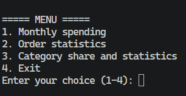
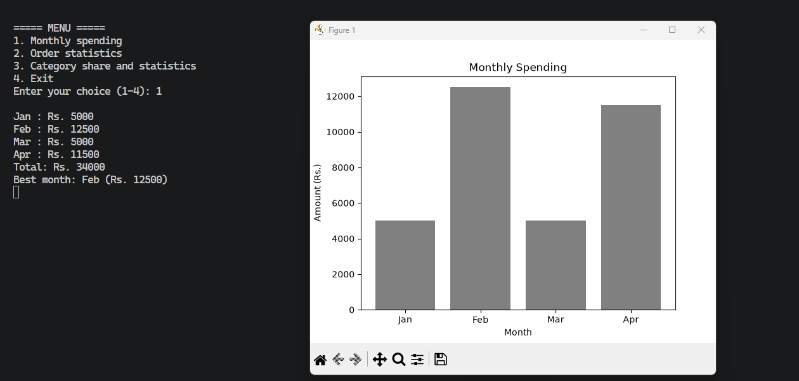
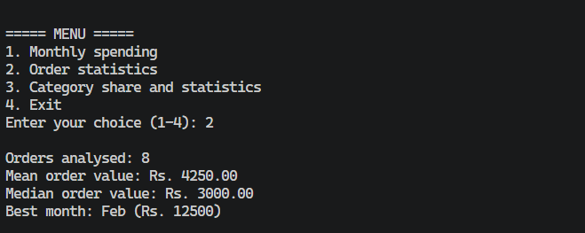
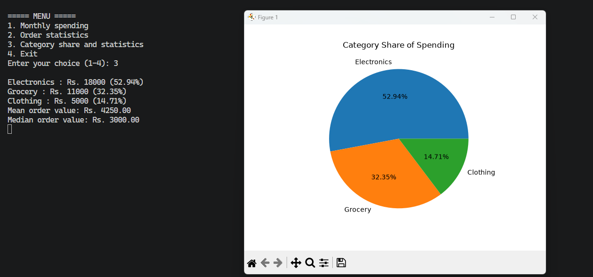

# Orders Analysis Program: Summary

## Overview

This is a menu-driven Python program that reads an `orders.csv` file and analyses customer order data. It uses **pandas** for data handling, **NumPy** for statistics and **Matplotlib** for charts.

The CSV file must have these columns:

| Column | Description |
|--------|-------------|
| `Month` | Month abbreviation (Jan, Feb, ..., Dec) |
| `Category` | Category of the order |
| `Amount` | Order value in rupees (must be a non-negative number) |

---

## How the Program Works

### 1. Loading and cleaning data (`load_data`)
- Reads the CSV with every column as text, then strips extra spaces from column names, `Month` and `Category`.
- Converts `Amount` to numbers. Anything that is not a number becomes `NaN`.
- Prints a warning for each bad row (non-numeric or negative `Amount`) and skips it.
- Returns only the valid rows. If the file is missing, it prints an error and returns `None`.

### 2. Helper functions
- `show(value)`: prints whole numbers without `.0` (2000.0 becomes 2000).
- `get_monthly_totals(df)`: sums `Amount` per month and returns the months in calendar order using `MONTH_ORDER`.
- `print_best_month(names, values)`: prints the month with the highest total.
- `print_mean_and_median(df)`: prints the mean and median order value to 2 decimals.

### 3. Menu options

| Option | Function | What it does |
|--------|----------|--------------|
| 1 | `monthly_spending` | Prints total spending for each month, the overall total and the best month. Shows a bar chart. |
| 2 | `order_statistics` | Prints the number of orders, mean, median and best month. |
| 3 | `category_share` | Prints each category's total and percentage share (highest first), plus mean and median. Shows a pie chart. |
| 4 | Exit | Ends the program. |

### 4. Main loop (`main`)
- Loads `orders.csv` and stops if the file is missing or has no valid rows.
- Shows the menu repeatedly until the user enters `4`.
- Any other input prints "Invalid choice" and the menu appears again.

---

## Output Screenshots

> Save your screenshots in an `images/` folder next to this file and rename them to match the paths below (or edit the paths).

### 1. Main Menu



### 2. Option 1: Monthly Spending (text output and bar chart)



### 3. Option 2: Order Statistics



### 4. Option 3: Category Share (text output and pie chart)



---

## Error Handling

- Missing file: prints an error and stops the program.
- Non-numeric or negative `Amount`: a warning is printed with the row number and the row is skipped.
- No valid rows: the program prints a message and exits.
- Invalid menu input: the user is asked to enter a number from 1 to 4.

## How to Run

```bash
pip install pandas numpy matplotlib
python your_file_name.py
```

Make sure `orders.csv` is in the same folder as the script.
